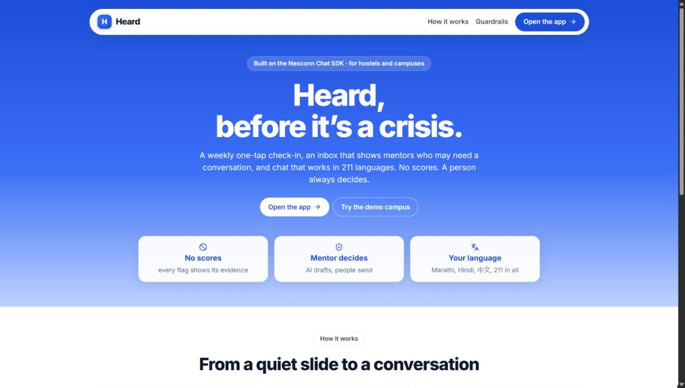
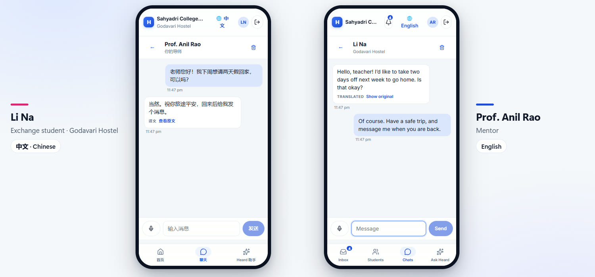
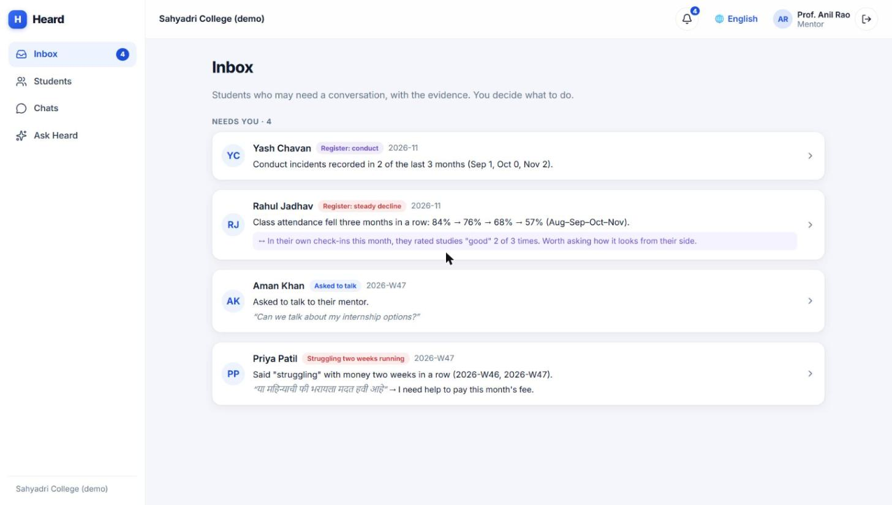
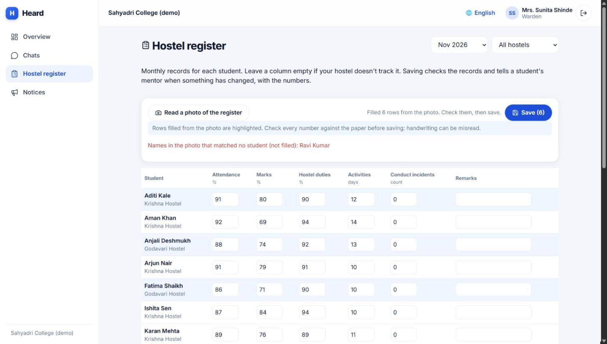
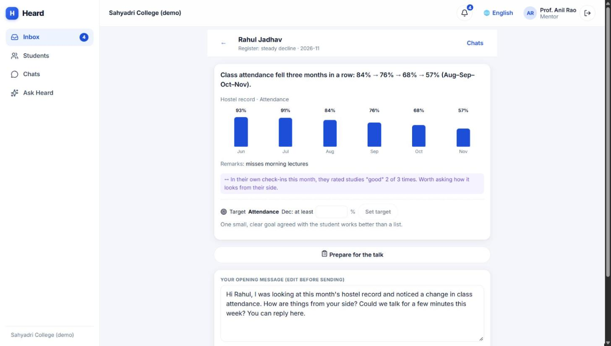
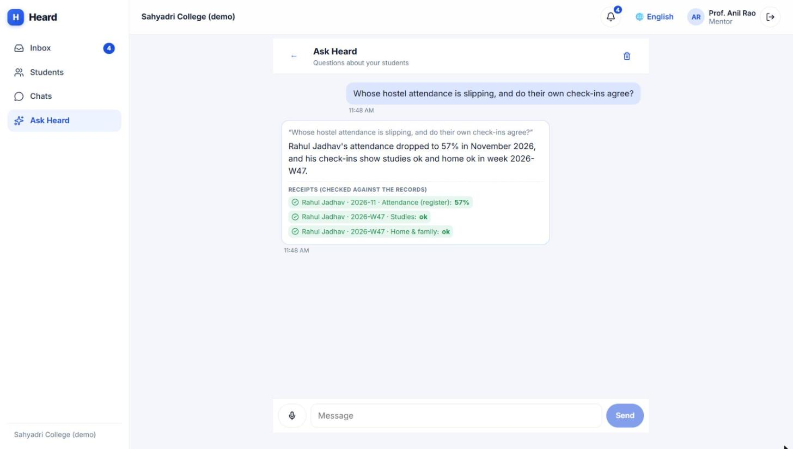
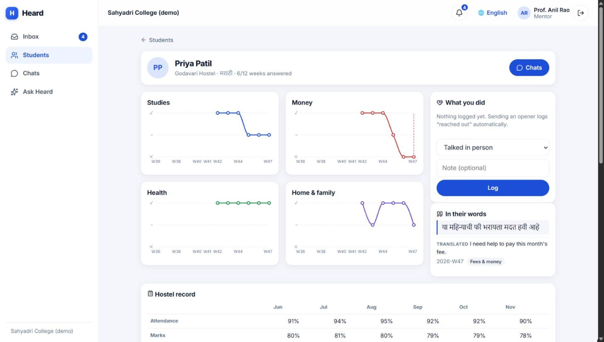
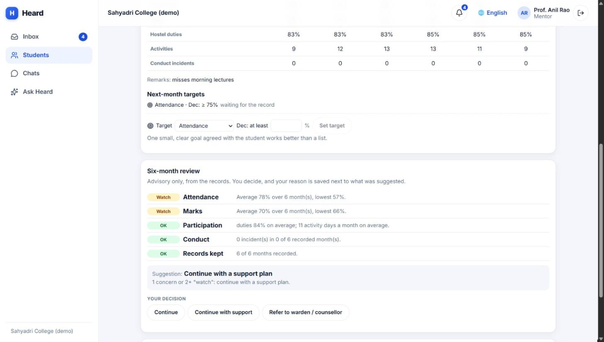
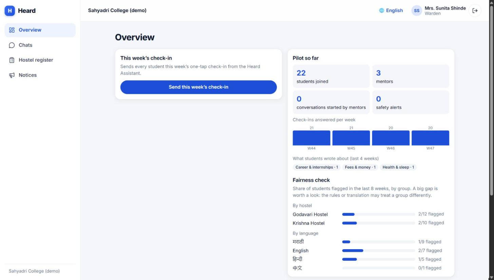
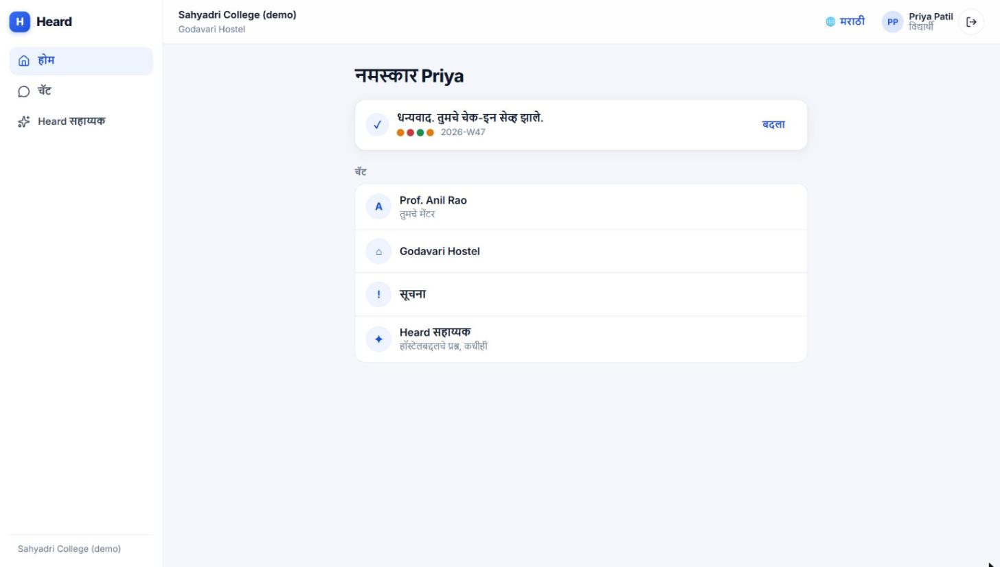

<div align="center">

# Heard

### Hostel students, heard before it's a crisis.

A campus chat app on the **Nexconn Chat SDK**: a weekly one-tap check-in, an inbox that shows a mentor *who* may need a conversation and *why*, the hostel's own monthly register, and chat that works across Marathi, Hindi, English, Chinese and 200+ other languages.

**No scores. No labels. A person always decides.**

**[Live app](https://heard-web.onrender.com)** · **[Demo video](https://youtu.be/CgqiAs0Kykw)** · **[Write-up (PDF)](docs/Heard-writeup.pdf)** · Nexconn Build Challenge 2026 · Humanitarian & Social Good



</div>

---

## Try it

1. Open **https://heard-web.onrender.com** → **Try the demo campus**. The passcode is in our submission write-up.
2. Pick a person. Everyone on "Sahyadri College (demo)" is fake.

| Log in as | What to look at |
|---|---|
| **Prof. Anil Rao** (mentor, English) | Inbox with evidence cards → open **Rahul** (attendance slipping in the hostel register) → *Prepare for the talk* → edit and send the opener. **Ask Heard**: "who is struggling with money?" |
| **Priya Patil** (student, Marathi) | The one-tap check-in, the hostel assistant, and chat with her mentor. She writes Marathi, Prof. Rao reads English. |
| **Li Na** (student, Chinese) | Chat with Prof. Rao: she writes and reads Chinese, he writes and reads English (Nexconn translation). |
| **Mrs. Sunita Shinde** (warden) | **Hostel register** (read a photo of the paper register), the overview, the fairness check. |

> The free server sleeps when idle: the first load can take up to a minute.

## The problem

On most Indian campuses, a mentor or warden first hears that a hostel student is struggling at an exam, a disciplinary hearing or a crisis. By then it is no longer a conversation. Students rarely start that conversation themselves, especially about money, homesickness or health. Many are more at ease in Marathi or Hindi than in English. Hostel communication runs on noisy group chats with no roles and no follow-up. Meanwhile the hostel's paper register, which often shows the slide first, sits in a cupboard until the six-month review.

## What Heard does

<p align="center"></p>

**One chat, two languages.** Li Na writes and reads Chinese; Prof. Rao writes and reads English. Nexconn's message translation sits in between: every message arrives in the reader's own language, labelled *Translated*, with the original one tap away.

| | |
|---|---|
|  | **An inbox of evidence, not scores.** Plain rules (two "struggling" weeks in a row, a drop from the student's own usual, two weeks of silence, "I'd like to talk", attendance falling three months running) raise a card for that student's mentor. Every card shows exactly why, with the student's own words, translated. |
|  | **The register the hostel already keeps.** The warden photographs the paper register. Gemini fills the table, every filled row is highlighted for checking, and nothing is saved until a person presses Save. Names that match no student are listed, never guessed. |
|  | **The gap is the conversation.** Rahul's attendance fell 84% → 76% → 68% → 57%, yet in his own check-ins he called studies "good". Heard shows both, as a question to ask him, not a verdict. The mentor can set one next-month target; when the record meets it, the card closes by itself. |
|  | **AI you can check.** *Ask Heard* answers questions about your own students, and every claim carries a receipt (student, week, value) that **code** checks against the database before it is shown. The meeting card works the same way: points that don't match the records are removed. |
|  | **A student's journey on one page.** Check-in charts with flag weeks and help weeks marked, *In their words* (translated, tagged by topic), what the mentor did, and whether things **improved after help**. |
|  | **An advisory six-month review.** Each criterion is OK / Watch / Concern with the numbers behind it. The suggestion never goes beyond "discuss at the review meeting". The mentor decides and writes the reason, which is stored next to what was suggested. |
|  | **For wardens: counts, not notes.** Check-in numbers, the topics students wrote about, and a **fairness check**: flag rates by hostel and by language, so a rule or a translation that treats one group differently shows up. |
|  | **In the student's language.** The full UI is in English, हिन्दी, मराठी and 中文. Chat is translated between any of Nexconn's 211 languages, with the original one tap away. Indian scripts go through Gemini, because in our tests Nexconn turned a Marathi request into its opposite. |

**Also:**
- **Safety path, in code, not AI.** Self-harm and ragging keywords in four languages, in any student message (also caught server-side by a Nexconn webhook), show the student the Tele-MANAS helpline (14416) and alert the mentor and every warden at once.
- **Tone Guard** catches a blaming or clinical opener before the mentor sends it.
- **Voice notes** are sent as Nexconn HD voice messages, transcribed and translated.
- **A hostel handbook assistant** answers in the student's own language and hands anything personal to their mentor.

## Nexconn features we use

| Nexconn feature | Where in Heard |
|---|---|
| Chat SDK for Web (`@nexconn/chat` 26.2.1), with our own mobile-first React screens | every chat screen |
| Community channel + subchannels (public per hostel; private notices and mentors' room) | the campus |
| Direct channels | student ↔ mentor, student ↔ assistant, mentor ↔ Ask Heard |
| Custom messages: `SA:PulseCard`, `SA:PulseResp`, `SA:FlagCard`, `SA:Notice`, `SA:SafetyCard`, `SA:AskAnswer` | check-ins, flags, notices, the helpline card, Ask Heard answers |
| Message translation (`translateMessages`) | chat translation, e.g. Chinese ↔ English |
| HD voice messages | voice notes |
| Bot user with server-sent messages | Heard Assistant, Ask Heard, flag cards |
| Server API: tokens, send, community and subchannel setup, user soft-delete | sign-in, campus setup, the right to be forgotten |
| Webhooks (`message:send`, signature verified) | the safety check on every student message |
| Message history, clear-for-me | chat history, *Clear chat* |

Data centre: Singapore. Our API and database run in Singapore too.

## Guardrails

- **No risk scores, no labels, no diagnosis.** Openers containing labels ("depressed", "at risk", …) are refused in code.
- **The AI never contacts a student.** It drafts; a mentor edits and sends as themselves.
- **The app never suggests removing a student.** "Discuss at the review meeting" is its strongest suggestion.
- **Every AI claim is checked by code** against the records (Ask Heard, the meeting card), and the photo reader only fills a table a person must confirm.
- **Privacy:** a privacy notice must be accepted at join. Mentors see only their own students; wardens see counts, never notes. Deletion on request removes the student here and on Nexconn.
- **Demo data only** in this repo and the demo campus.

## Does it work?

- **149 automated tests** (rules, API, safety path, translation routing, register, AI fallbacks). Every commit is gated on tests, typecheck and build.
- **Rule proof** ([docs/PROOF.md](docs/PROOF.md)): on synthetic cohorts with planted problems, the inbox rules caught every planted problem but one, across three noise levels. On a calm cohort about 1 in 100 ordinary students gets a flag; on a noisy one, about 1 in 8. Every flag shows its evidence, so a mentor can dismiss it with a reason.
- **Photo reader:** on a handwritten-style register page, it read every value correctly in about 5 seconds, matched "Yash C." to the right student and left an unknown name unmatched ([sample page](docs/screenshots/paper-register-sample.jpg)).
- **Traction:** Heard is **pilot-ready, not yet piloted.** We want a college welfare cell or counsellor on board before real students use it. Setup takes a day: one command creates a campus with capped, expiring join codes and printable QR posters ([pilot kit](docs/pilot/README.md)).

## Architecture

```
React 19 + Vite (web, mobile-first) ──── Nexconn Chat SDK ────► Nexconn (Singapore)
        │  REST                                                     │ webhooks (message:send)
        ▼                                                           ▼
Hono API on Node ── Drizzle ──► Postgres (Neon, Singapore)   /webhooks/nexconn → safety check
   │   rules, flags, register, review (pure functions in packages/shared, unit-tested)
   └── Gemini (optional): Indian-language translation, drafts, Ask Heard, photo reading, transcripts
```

- `packages/shared`: message types, flag rules, register rules, the six-month review, languages (pure TypeScript, tested)
- `apps/api`: Hono API, Nexconn server client, Drizzle schema + migrations, demo seed, campus tools
- `apps/web`: React screens for students, mentors and wardens

Every AI feature is optional: without a Gemini key, check-ins, flags, the register, chat and Nexconn translation still work.

## Run it locally

Needs Node 22+ and pnpm 10. No database to install: locally the API uses an embedded Postgres (PGlite).

```bash
pnpm install
cp .env.example .env                 # Nexconn App Key/Secret, DEMO_PASSCODE, optional GEMINI_API_KEY
pnpm --filter @heard/api seed:demo   # the fake demo campus, in the database and on Nexconn
pnpm dev                             # API on :8787, web on :5173
pnpm test
```

Full developer guide (API reference, deploy, campus tools): [docs/DEVELOPERS.md](docs/DEVELOPERS.md).

## Built during the challenge

Heard is a **new codebase**, written during the Nexconn Build Challenge (Oct 31 – Nov 22, 2026); see the commit history. The concept grew out of an earlier student-support prototype by our team. No code, data or design from it is reused.

**Team:** Aditya Chimurkar, Om.
